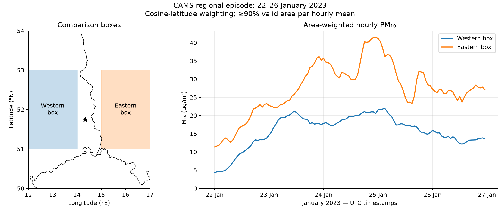
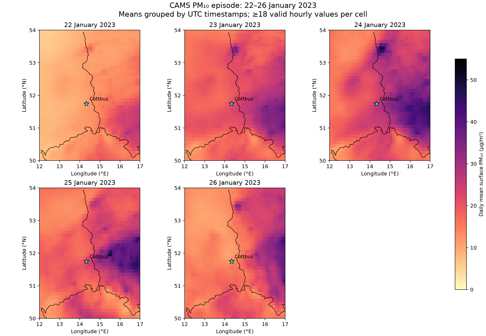
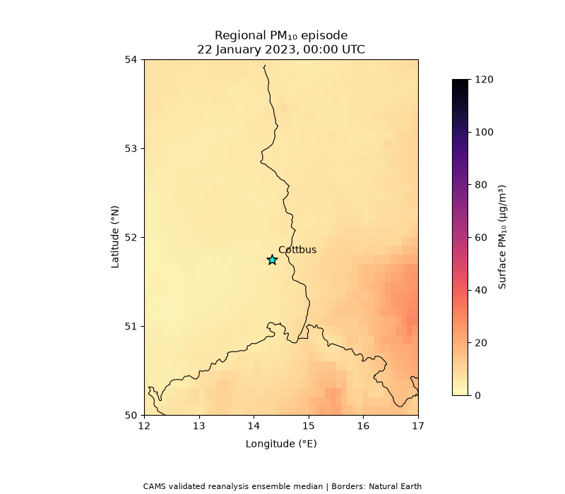

# Regional PM10 Episode Study

A reproducible Python case study of CAMS surface PM10 over eastern
Germany and neighbouring regions, 22–26 January 2023.

## Results

| January 2023 | Western box (µg/m³) | Eastern box (µg/m³) |
|---|---:|---:|
| 22 | 9.17 | 17.07 |
| 23 | 18.65 | 27.64 |
| 24 | 19.32 | 34.46 |
| 25 | 17.98 | 31.19 |
| 26 | 13.79 | 26.51 |

Both boxes reached their highest daily mean on 24 January.
The eastern-minus-western difference that day was 15.14 µg/m³.
The full-domain daily mean increased from 12.50 µg/m³ on 22 January
to 23.70 µg/m³ on 24 January.

## Data and methods

- CAMS European air quality validated reanalysis, ensemble median.
- Surface PM10 in µg/m³ on a regular 0.1° grid.
- Domain: 50–54°N, 12–17°E.
- Episode: 22 January 00:00 to 26 January 23:00 UTC, 2023.
- Western box: 51–53°N, 12–14°E.
- Eastern box: 51–53°N, 15–17°E.
- Boxes include lower bounds and exclude upper bounds.
- Each box contains 400 grid centres.
- Spatial means use cosine-latitude weights.
- Hourly box means require ≥90% valid weighted area.
- Daily box means require ≥18 valid hourly means.
- Daily maps require ≥18 valid hours per grid cell.
- Nonfinite and negative concentrations are excluded.
- Both boxes had complete spatial coverage throughout this episode.
- The animation uses a fixed colour scale across 120 frames.
- The map star marks Cottbus.

## Reproduction

Use Python 3.11 and install dependencies with
`python -m pip install -r requirements.txt` inside a virtual environment.

Download January 2023 from the
[CAMS catalogue](https://ads.atmosphere.copernicus.eu/datasets/cams-europe-air-quality-reanalyses):
particulate matter 10 µm, ensemble, level 0, validated reanalysis.

Extract the download, then run:

    python scripts/prepare_cams.py --input /path/to/cams.eaq.vra.ENSa.pm10.l0.2023-01.nc
    python scripts/plot_daily_maps.py
    python scripts/animate_episode.py
    python scripts/plot_regional_timeseries.py

Figures and diagnostic CSV files are saved in docs/figures/.
Cartopy downloads Natural Earth boundaries on first use.
Input NetCDF data and virtual environments are excluded from Git.

## Limitations

This is a descriptive reanalysis case study. Maps and spatial contrasts
alone do not establish transport direction, emission sources or national
contributions. Meteorological diagnostics and source-attribution methods
would be needed to investigate those questions.

The geographical boxes are not national averages.
Five days do not establish climatological behaviour.

Daily means group values by their supplied UTC timestamps. The precise
CAMS hourly averaging interval relative to each timestamp has not been
independently verified. These are not regulatory daily-mean assessments.

This project does not perform independent observational validation.
See the companion [Cottbus evaluation project](https://github.com/muhshif/cams-pm-evaluation-germany).

## Sources

- CAMS: https://doi.org/10.24381/7cc0465a
- Contains modified Copernicus Atmosphere Monitoring Service information [2023].
  Neither the European Commission nor ECMWF is responsible for any use
  that may be made of the information it contains.
- Boundaries: Natural Earth, public domain.
- Code: MIT licence. Source data retain their respective terms.
